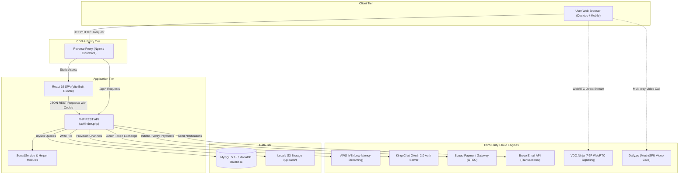
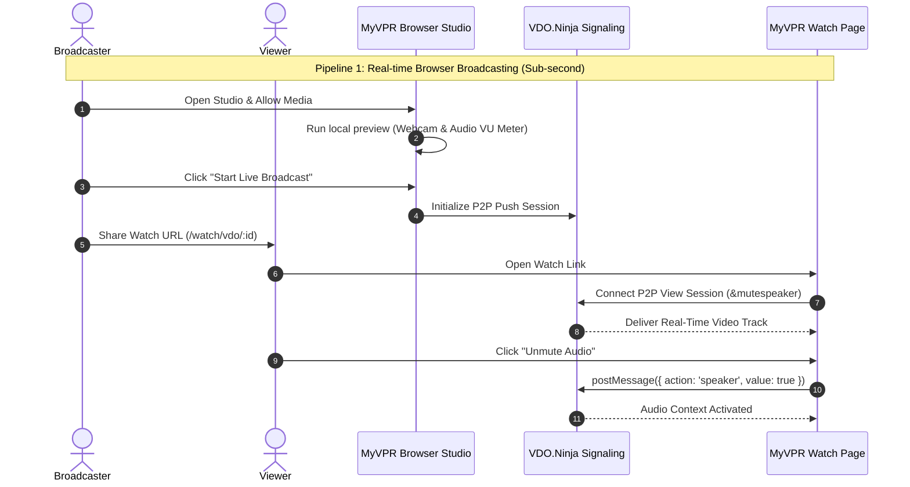

# System Architecture — MyVPR

This document details the multi-tier architectural design of the MyVPR platform, explaining data flow, component interactions, security boundaries, and streaming pipelines.

---

## 1. Architectural Topology



---

## 2. Component Breakdown

### A. Client Presentation Tier (`new/`)
- Built as a modern Single Page Application (SPA) using React 19 and Vite 8.
- Utilizes `react-router-dom` (v7) for client-side routing with route-level code splitting via `React.lazy()` and `<Suspense>`.
- Communicates with the backend exclusively through `src/services/api.js`.
- Maintains local authorization state in `AuthContext.jsx` while relying on the backend HTTP-only session cookie as the single source of truth.

### B. Gateway & Application Tier (`api/`)
- Single Entry Point Architecture: All API calls enter through `api/index.php`.
- The router parses the request method (`GET`, `POST`, `PUT`, `DELETE`) and canonical path (`/auth/login`, `/crusades`, `/subscriptions/plans`).
- Dynamic path segments are matched via regular expressions (e.g. `/crusades/([A-Za-z0-9]+)/stats`).
- Endpoint logic is organized into modular files in `api/endpoints/`.
- Decoupled services (such as `api/services/SquadService.php`) encapsulate business logic and third-party integrations.

### C. Data Persistence Tier (`includes/db.php`)
- Relational schema hosted on MySQL 5.7+ or MariaDB 10.3+.
- Database access utilizes PHP's `mysqli` extension with prepared statements and parameterized queries (`$stmt->bind_param(...)`) to prevent SQL injection.
- Transactions are wrapped in `mysqli::begin_transaction()` and `mysqli::commit()` for multi-step mutations (e.g., subscription activations and payment ledger records).

---

## 3. Security Model & Boundaries

### A. Cross-Origin Resource Sharing (CORS)
The API strictly validates incoming `Origin` headers against an approved whitelist defined in `api/index.php`:
- `http://localhost:5173` (Vite local development)
- `http://localhost:3000` (Legacy dev server)
- `https://myvpr.org` (Production domain)
- Dynamic detection of `REACT_APP_URL` from the environment.

When an origin matches, the server issues:
```http
Access-Control-Allow-Origin: <matching-origin>
Access-Control-Allow-Credentials: true
Access-Control-Allow-Methods: GET, POST, PUT, PATCH, DELETE, OPTIONS
Access-Control-Allow-Headers: Content-Type, Authorization, X-CSRF-Token, X-Requested-With, x-squad-encrypted-body, x-squad-signature
```

### B. Cross-Site Request Forgery (CSRF) Protection
State-mutating endpoints (`POST`, `PUT`, `DELETE`, `PATCH`) enforce anti-CSRF verification:
1. The frontend requests a cryptographic CSRF token via `GET /csrf`.
2. The token is generated via `bin2hex(random_bytes(32))` and persisted in `$_SESSION['csrf_token']`.
3. Client requests pass the token in the `X-CSRF-Token` HTTP header.
4. The server validates the token using `hash_equals($_SESSION['csrf_token'], $providedToken)`.

### C. Session & Cookie Security
- Sessions use secure PHP cookie flags configured in `includes/session.php`:
  - `httponly`: `true` (blocks JavaScript access)
  - `samesite`: `'Lax'` (mitigates cross-site request attacks)
  - `secure`: Automatically set to `true` when HTTPS is active.
- **Remember-Me Persistence**: Utilizes split-token authentication (`selector` + `authenticator`):
  - `selector`: 16-hex character token queried directly.
  - `authenticator`: 64-hex character token hashed with `password_hash()` in the database to prevent timing attacks.

---

## 4. Streaming Architecture & Pipelines

MyVPR offers two complementary broadcasting architectures to serve different needs:



### 1. Browser Studio Pipeline (WebRTC)
- **Engine**: Peer-to-peer WebRTC via clean VDO.Ninja embed.
- **Latency**: Sub-second (< 300 ms).
- **Target Audience**: Pastors, small congregations, prayer cells, and impromptu live broadcasts directly from Chrome/Edge/Safari/Firefox.
- **Zero Cloud Cost**: Video and audio travel peer-to-peer or through public STUN/TURN relays with no per-minute AWS server fees.
- **Autoplay Handling**: Viewers load with `&mutespeaker` to bypass browser autoplay restrictions; clicking the audio banner triggers postMessage unmute.

### 2. Cloud Studio Pipeline (AWS IVS)
- **Engine**: Amazon Interactive Video Service (IVS).
- **Ingestion**: Standard RTMP / RTMPS from OBS Studio, vMix, or Wirecast.
- **Delivery**: Low-Latency HLS across Amazon CloudFront global edge networks.
- **Latency**: 2 to 4 seconds.
- **Target Audience**: Sunday morning services, digital crusade main sessions, and global broadcasts with tens of thousands of simultaneous viewers.
