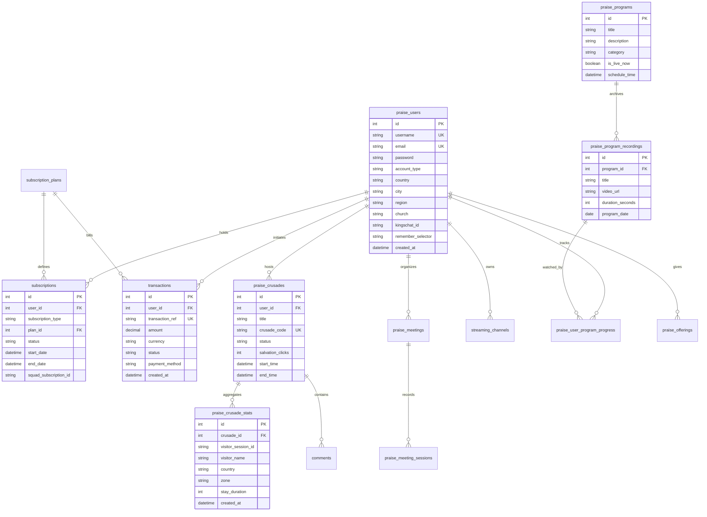

# Database Documentation — MyVPR

This document provides a comprehensive reference for the MyVPR relational database schema, table definitions, relationships, constraints, and migration management.

---

## 1. Database Specifications

- **Database Engine**: MySQL (>= 5.7 / 8.0) or MariaDB (>= 10.3)
- **Default Storage Engine**: `InnoDB` (ACID compliance, row-level locking, foreign key enforcement)
- **Character Set**: `utf8mb4`
- **Collation**: `utf8mb4_unicode_ci` or `utf8mb4_general_ci`
- **Timezone**: All internal timestamps are stored in Coordinated Universal Time (`UTC`).

---

## 2. Entity-Relationship (ER) Diagram



---

## 3. Core Table Catalog

### 1. `praise_users`
Stores primary user accounts, credentials, church affiliations, and KingsChat identity.
- `id` (`INT`, PK, Auto-increment)
- `username` (`VARCHAR(50)`, Unique): Alphanumeric user handle.
- `email` (`VARCHAR(100)`, Unique): Primary contact email.
- `password` (`VARCHAR(255)`): Bcrypt/Argon2id password hash.
- `account_type` (`VARCHAR(20)`): `'individual'`, `'campus_fellowship'`, `'church_service'`, `'admin'`.
- `country`, `city`, `region`, `church`: Geographical and church organization hierarchy.
- `kingschat_id` (`VARCHAR(100)`, Nullable): KingsChat OpenID profile identifier.
- `kingschat_username` (`VARCHAR(100)`, Nullable): Synced KingsChat handle.
- `remember_selector` (`VARCHAR(64)`, Nullable): Persistent login cookie selector.
- `remember_token` (`VARCHAR(255)`, Nullable): Hashed authenticator token.
- `token_expiry` (`DATETIME`, Nullable): Cookie expiration timestamp.
- `created_at` (`DATETIME`): Account registration timestamp.

### 2. `subscription_plans`
Authoritative dynamic plan definitions for membership and studio broadcasting tiers.
- `id` (`INT`, PK, Auto-increment)
- `plan_code` (`VARCHAR(50)`, Unique): e.g. `'member_monthly'`, `'streamer_pro_monthly'`.
- `name` (`VARCHAR(100)`): Display name (e.g. `'Premium Member'`).
- `category` (`VARCHAR(30)`): `'membership'`, `'streaming'`, `'partner'`.
- `price` (`DECIMAL(10,2)`): Plan price in primary currency.
- `currency` (`VARCHAR(3)`): `'NGN'`, `'USD'`.
- `interval_unit` (`VARCHAR(20)`): `'month'`, `'year'`.
- `interval_count` (`INT`): Default `1`.
- `features_json` (`LONGTEXT`): JSON array of marketing bullet points.
- `limits_json` (`LONGTEXT`): JSON key-value pairs of technical quotas (resolution, viewers, duration).
- `is_active` (`TINYINT(1)`): `1` if open for subscription.
- `badge_text` (`VARCHAR(50)`): e.g. `'Most Popular'`, `'Best Value'`.

### 3. `subscriptions`
Active and historical user subscription records.
- `id` (`INT`, PK, Auto-increment)
- `user_id` (`INT`, FK -> `praise_users.id` ON DELETE CASCADE)
- `subscription_type` (`VARCHAR(20)`): `'membership'`, `'streaming'`, `'gift'`.
- `plan_id` (`INT`, FK -> `subscription_plans.id`)
- `status` (`ENUM('active', 'expired', 'cancelled', 'pending')`): Current subscription standing.
- `start_date` (`DATETIME`): Activation timestamp.
- `end_date` (`DATETIME`): Expiration timestamp.
- `squad_subscription_id` (`VARCHAR(100)`, Nullable): Recurring subscription reference in Squad.

### 4. `transactions`
Financial payment ledger records for card transactions, bank transfers, and crypto gifts.
- `id` (`INT`, PK, Auto-increment)
- `user_id` (`INT`, FK -> `praise_users.id`, Nullable)
- `plan_id` (`INT`, FK -> `subscription_plans.id`, Nullable)
- `transaction_ref` (`VARCHAR(100)`, Unique): Cryptographically random reference (e.g. `vpr_txn_1712345678_abcd`).
- `amount` (`DECIMAL(10,2)`): Transaction value.
- `currency` (`VARCHAR(3)`): `'NGN'`, `'USD'`.
- `status` (`ENUM('pending', 'approved', 'failed', 'refunded')`): Settlement state.
- `payment_method` (`VARCHAR(50)`): `'squad'`, `'card'`, `'bank_transfer'`, `'ussd'`, `'espees'`, `'manual'`.
- `gateway_response` (`LONGTEXT`, Nullable): JSON payload returned by the gateway.
- `created_at` (`DATETIME`): Initial transaction creation timestamp.

### 5. `praise_crusades`
Digital evangelism crusades and online outreach campaigns.
- `id` (`INT`, PK, Auto-increment)
- `user_id` (`INT`, FK -> `praise_users.id` ON DELETE CASCADE)
- `title` (`VARCHAR(255)`): Crusade campaign title.
- `description` (`TEXT`, Nullable): Ministry details and sermon theme.
- `crusade_code` (`VARCHAR(255)`, Unique): Short code used in audience URLs.
- `status` (`VARCHAR(20)`): `'draft'`, `'scheduled'`, `'live'`, `'ended'`, `'cancelled'`.
- `is_active` (`TINYINT(1)`): `1` if actively accepting visitors.
- `salvation_clicks` (`INT`): Counter of visitors clicking the salvation decision CTA.
- `thumbnail_url` (`VARCHAR(500)`, Nullable): Custom poster art URL.
- `timezone` (`VARCHAR(100)`): Scheduled time zone (e.g. `'Africa/Lagos'`).
- `start_time` (`DATETIME`, Nullable): Scheduled beginning time in UTC.
- `end_time` (`DATETIME`, Nullable): Scheduled conclusion time in UTC.

### 6. `praise_crusade_stats`
Granular visitor telemetry and analytics.
- `id` (`INT`, PK, Auto-increment)
- `crusade_id` (`INT`, FK -> `praise_crusades.id` ON DELETE CASCADE)
- `visitor_session_id` (`VARCHAR(100)`): Ephemeral browser session identifier.
- `visitor_name` (`VARCHAR(255)`, Nullable): Name if provided in live chat.
- `country` (`VARCHAR(100)`, Nullable): Geolocation country.
- `city` (`VARCHAR(100)`, Nullable): Geolocation city.
- `zone` (`VARCHAR(100)`, Nullable): Church administrative zone.
- `stay_duration` (`INT`): Time spent watching in seconds.
- `created_at` (`DATETIME`): Entry timestamp.

### 7. `praise_programs` & `praise_program_recordings`
Broadcast TV program schedules and on-demand ministration video archives.
- `praise_programs`: `id`, `title`, `description`, `thumbnail_url`, `category`, `schedule_time`, `is_live_now`.
- `praise_program_recordings`: `id`, `program_id` (FK), `title`, `description`, `thumbnail_url`, `video_url`, `duration_seconds`, `program_date`, `category`, `status`.

---

## 4. Migration Procedures

Database schema modifications are managed through versioned SQL scripts in `migrations/`:

| Migration File | Description |
| :--- | :--- |
| `001_crusade_enhancements.sql` | Adds timezone, status, and analytics columns to `praise_crusades`. |
| `002_squad_payments_and_subscriptions.sql` | Introduces `subscription_plans`, `payment_audit_logs`, and recurring billing. |
| `003_kingschat_oauth.sql` | Adds `oauth_states`, `kingschat_oauth_tokens`, and user profile mappings. |
| `004_programs_recordings_and_watch_history.sql` | Creates structured VOD programs, recordings, and continue-watching tracking. |

### Running Migrations via CLI
Execute the migration runner from the project root:
```bash
php run_db_migrations.php
```
The runner verifies table and column existence dynamically before executing `ALTER TABLE` or `CREATE TABLE` commands, preventing accidental syntax errors or duplicate index errors.
