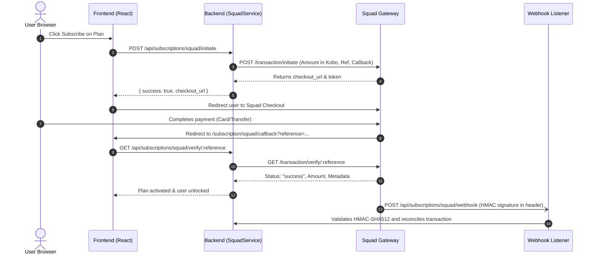

# MyVPR — Third-Party Integrations Guide

This document provides a comprehensive operational guide for every third-party service and external API integrated into the MyVPR platform. It details their purpose, underlying workflow, frontend/backend touchpoints, required configuration variables, dashboard setup, and troubleshooting.

---

## 1. Summary of Platform Integrations

| Service | Category | Implementation State | Key Files |
| :--- | :--- | :--- | :--- |
| **Squad (HabariPay / GTCO)** | Payment Gateway | **Production Ready** | [`api/services/SquadService.php`](file:///Users/home/Documents/myvprNew/final_vpr/api/services/SquadService.php), [`api/endpoints/subscriptions.php`](file:///Users/home/Documents/myvprNew/final_vpr/api/endpoints/subscriptions.php), [`new/src/pages/subscription/CheckoutPage.jsx`](file:///Users/home/Documents/myvprNew/final_vpr/new/src/pages/subscription/CheckoutPage.jsx) |
| **KingsChat OAuth 2.0** | SSO Authentication | **Production Ready** | [`api/index.php`](file:///Users/home/Documents/myvprNew/final_vpr/api/index.php#L123-L250), [`new/src/pages/auth/LoginPage.jsx`](file:///Users/home/Documents/myvprNew/final_vpr/new/src/pages/auth/LoginPage.jsx) |
| **Amazon IVS** | Low-Latency Live Streaming | **Configured & Active** | [`api/endpoints/streaming.php`](file:///Users/home/Documents/myvprNew/final_vpr/api/endpoints/streaming.php), [`new/src/pages/streaming/LivePlayerPage.jsx`](file:///Users/home/Documents/myvprNew/final_vpr/new/src/pages/streaming/LivePlayerPage.jsx) |
| **MyVPR Browser Studio (VDO.Ninja)** | WebRTC Browser Broadcasting | **Production Ready (Custom UI)** | [`new/src/pages/streaming/VdoStudioPage.jsx`](file:///Users/home/Documents/myvprNew/final_vpr/new/src/pages/streaming/VdoStudioPage.jsx), [`new/src/pages/streaming/VdoViewerPage.jsx`](file:///Users/home/Documents/myvprNew/final_vpr/new/src/pages/streaming/VdoViewerPage.jsx), [`api/endpoints/realtime.php`](file:///Users/home/Documents/myvprNew/final_vpr/api/endpoints/realtime.php) |
| **Daily.co** | Interactive Video Conferencing | **Implemented** | [`api/endpoints/meetings.php`](file:///Users/home/Documents/myvprNew/final_vpr/api/endpoints/meetings.php), [`new/src/pages/streaming/RealtimeStreamPage.jsx`](file:///Users/home/Documents/myvprNew/final_vpr/new/src/pages/streaming/RealtimeStreamPage.jsx) |
| **Brevo (Sendinblue)** | Transactional Email | **Configured** | [`includes/email_config.php`](file:///Users/home/Documents/myvprNew/final_vpr/includes/email_config.php), [`api/index.php`](file:///Users/home/Documents/myvprNew/final_vpr/api/index.php) |
| **Espees** | Faith-Based Digital Wallet | **Implemented (Proxy)** | [`api/espees_proxy.php`](file:///Users/home/Documents/myvprNew/final_vpr/api/espees_proxy.php), [`api/espees_callback.php`](file:///Users/home/Documents/myvprNew/final_vpr/api/espees_callback.php) |
| **Amazon S3** | Media Storage & Presigning | **Configured** | [`api/endpoints/programs.php`](file:///Users/home/Documents/myvprNew/final_vpr/api/endpoints/programs.php#L278-L384) |

---

## 2. Squad (HabariPay / GTCO) Payment Gateway

### Purpose
Squad processes credit/debit card payments, direct bank transfers, USSD, and recurring subscriptions for MyVPR streaming plans and partner offerings in Nigerian Naira (NGN) and US Dollars (USD).

### How It Works


### Configuration Variables
Set in `.env` or `api/.env`:
```dotenv
SQUAD_ENV=sandbox                     # "sandbox" or "production"
SQUAD_PUBLIC_KEY=sandbox_pk_sample... # Public key for inline checkout
SQUAD_SECRET_KEY=sandbox_sk_sample... # Secret key for server-to-server API calls
SQUAD_WEBHOOK_SECRET=your_secret_hash # Secret used to compute HMAC-SHA512
```

### Webhook Verification
Squad signs webhook notifications using HMAC-SHA512. The signature is transmitted in HTTP header `x-squad-encrypted-body` (or `x-squad-signature`).
In [`api/services/SquadService.php`](file:///Users/home/Documents/myvprNew/final_vpr/api/services/SquadService.php):
```php
$computedHash = hash_hmac('sha512', $rawPayload, $signingKey);
if (!hash_equals(strtolower($computedHash), strtolower($headerSignature))) {
    // Reject untrusted payload with 401 Unauthorized
}
```

### External Dashboard Setup
1. Log in to [Squad Merchant Portal](https://dashboard.squadco.com/).
2. Navigate to **Settings > API & Webhooks**.
3. Set Webhook URL to: `https://myvpr.org/api/subscriptions/squad/webhook`
4. Set Callback URL to: `https://myvpr.org/subscription/squad/callback`
5. Enable notifications for: `charge.successful`, `transfer.successful`.

---

## 3. KingsChat Single Sign-On (OAuth 2.0)

### Purpose
Allows millions of LoveWorld / Christ Embassy members worldwide to authenticate to MyVPR with one click using their KingsChat profile.

### How It Works
1. **User clicks "Continue with KingsChat"**:
   - Frontend calls `GET /api/auth/kingschat/start`.
   - Backend generates a 64-character random `state` token, inserts it into `oauth_states` with a 10-minute expiry, and constructs the KingsChat authorization URL:
     `https://accounts.kingsch.at?clientId={KC_CLIENT_ID}&scopes=["send_chat_message"]&origin={state}&state={state}&redirect_uri={KC_REDIRECT_URI}`.
2. **User authorizes in KingsChat**:
   - KingsChat redirects browser back to `https://myvpr.org/api/auth/kingschat/callback?code=AUTH_CODE&origin=STATE`.
3. **Backend code exchange**:
   - Validates that `origin`/`state` exists in `oauth_states` (CSRF mitigation) and deletes it immediately.
   - Makes `POST https://connect.kingsch.at/developer/api/token` with `client_id`, `client_secret`, and `code`.
   - Receives `access_token` and queries `GET https://connect.kingsch.at/developer/api/profile`.
   - Checks if user exists in `praise_users` by `kc_user_id` or email; creates account if new, creates PHP session, and redirects to frontend with auth cookie.

### Configuration Variables
```dotenv
KC_CLIENT_ID=vpr_app_client_id
KC_CLIENT_SECRET=vpr_app_client_secret
KC_REDIRECT_URI=https://myvpr.org/api/auth/kingschat/callback
KC_AUTH_URL=https://accounts.kingsch.at
KC_TOKEN_URL=https://connect.kingsch.at/developer/api/token
KC_PROFILE_URL=https://connect.kingsch.at/developer/api/profile
```

---

## 4. Amazon Interactive Video Service (IVS)

### Purpose
Delivers broadcast-grade, ultra-low-latency (<3 seconds) live video streaming across desktop, mobile, and smart TVs using standard HLS (`.m3u8`).

### Architecture
- **Broadcaster Ingest**: Broadcasters stream via OBS, vMix, or hardware encoders using standard RTMPS.
- **Transcoding**: AWS automatically creates adaptive bitrate renditions (1080p, 720p, 480p, 360p, 160p).
- **Playback**: Delivered via global Amazon CloudFront CDN using HTTP Live Streaming.
- **Frontend Player**: Rendered inside [`new/src/pages/streaming/LivePlayerPage.jsx`](file:///Users/home/Documents/myvprNew/final_vpr/new/src/pages/streaming/LivePlayerPage.jsx) using Video.js and Amazon IVS Web SDK.

### Configuration Variables
```dotenv
AWS_ACCESS_KEY_ID=AKIA...
AWS_SECRET_ACCESS_KEY=...
AWS_REGION=eu-west-1
AWS_IVS_CHANNEL_ARN=arn:aws:ivs:eu-west-1:123456789012:channel/abc123xyz
AWS_IVS_STREAM_KEY=sk_eu-west-1_...
AWS_IVS_INGEST_ENDPOINT=rtmps://a1b2c3.global-contribute.live-video.net:443/app/
AWS_IVS_PLAYBACK_URL=https://a1b2c3.eu-west-1.playback.live-video.net/api/video/v1/master.m3u8
```

---

## 5. MyVPR Browser Studio (WebRTC Broadcast)

### Purpose
Enables users to broadcast live audio and video directly from their web browser (Chrome, Safari, Firefox, Edge) without installing OBS, drivers, or desktop software.

### Implementation Details
- **Architecture**: Powered by peer-to-peer / mesh WebRTC infrastructure with clean white-labeling in MyVPR.
- **Broadcaster Studio**: [`new/src/pages/streaming/VdoStudioPage.jsx`](file:///Users/home/Documents/myvprNew/final_vpr/new/src/pages/streaming/VdoStudioPage.jsx).
  - Prompts camera/microphone permissions through HTML5 `navigator.mediaDevices.getUserMedia`.
  - Displays preview, device selection, mute/video-off toggles, and broadcast state.
  - Generates secure room tokens: `room={roomId}&push={streamId}`.
- **Viewer Player**: [`new/src/pages/streaming/VdoViewerPage.jsx`](file:///Users/home/Documents/myvprNew/final_vpr/new/src/pages/streaming/VdoViewerPage.jsx).
  - Embedded player connects to `room={roomId}&view={streamId}`.
  - Automatically receives live feed without requiring viewer configuration.
- **Branding**: Completely white-labeled as "MyVPR Browser Studio" with zero visible third-party logos or branding elements.

---

## 6. Daily.co Video Conferencing

### Purpose
Supports interactive group meetings, prayer rooms, and panel discussions with multiple video participants simultaneously.

### Architecture
- **Backend**: [`api/endpoints/meetings.php`](file:///Users/home/Documents/myvprNew/final_vpr/api/endpoints/meetings.php) calls `https://api.daily.co/v1/rooms` to create ephemeral or scheduled rooms.
- **Security**: Rooms can be restricted to authenticated users using Daily room access tokens (`meeting_tokens`).
- **Frontend**: Rendered using `@daily-co/daily-js` or responsive iframe container in [`new/src/pages/streaming/RealtimeStreamPage.jsx`](file:///Users/home/Documents/myvprNew/final_vpr/new/src/pages/streaming/RealtimeStreamPage.jsx).

### Configuration Variables
```dotenv
DAILY_API_KEY=your_daily_co_private_key
DAILY_DOMAIN=myvpr.daily.co
```

---

## 7. Brevo (Sendinblue) Transactional Email Service

### Purpose
Sends account activation notices, password reset links, transaction receipts, and crusade reminders.

### Implementation Details
- Located in [`includes/email_config.php`](file:///Users/home/Documents/myvprNew/final_vpr/includes/email_config.php).
- Sends JSON payloads via cURL to `https://api.brevo.com/v3/smtp/email`.
- Sets sender to `noreply@myvpr.org` ("MyVPR Platform").

### Configuration Variables
```dotenv
BREVO_API_KEY=xkeysib-...
MAIL_FROM_EMAIL=noreply@myvpr.org
MAIL_FROM_NAME=MyVPR
```

---

## 8. Espees Digital Payment Integration

### Purpose
Allows church members to make offerings and subscriptions using Espees (LoveWorld digital currency).

### Implementation Details
- Handled through [`api/espees_proxy.php`](file:///Users/home/Documents/myvprNew/final_vpr/api/espees_proxy.php) and [`api/espees_callback.php`](file:///Users/home/Documents/myvprNew/final_vpr/api/espees_callback.php).
- Communicates with Espees merchant gateway API.
- Reconciles payment references into the `transactions` table.
